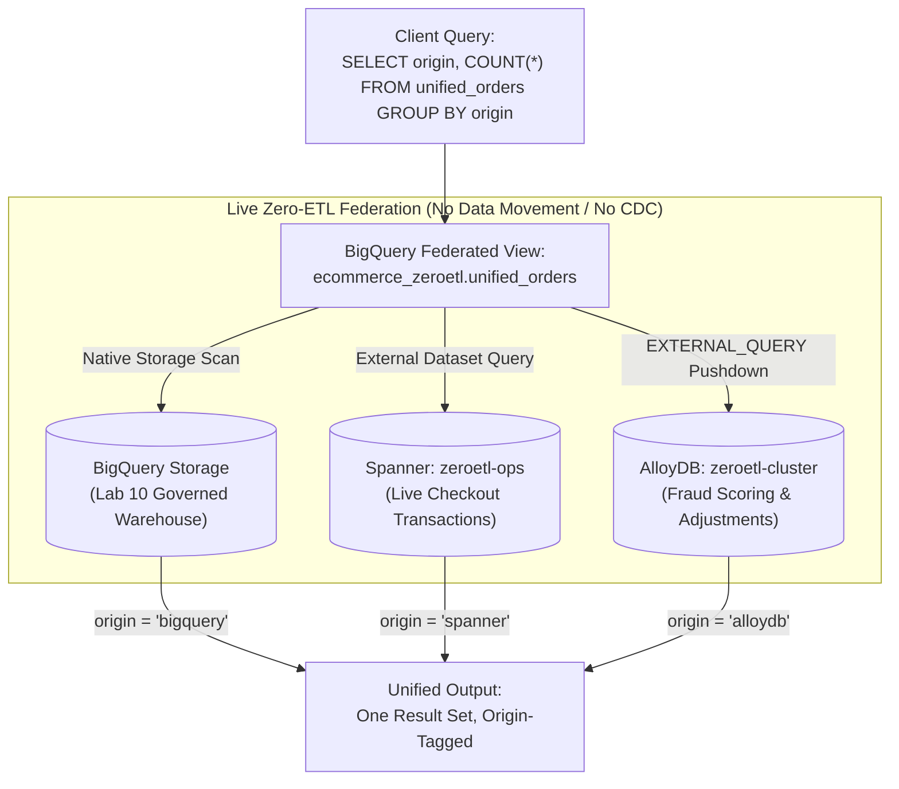
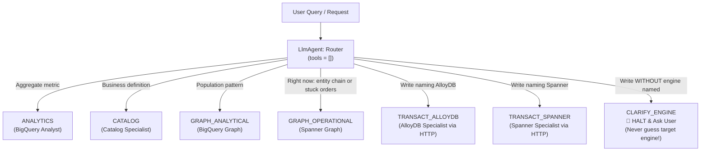
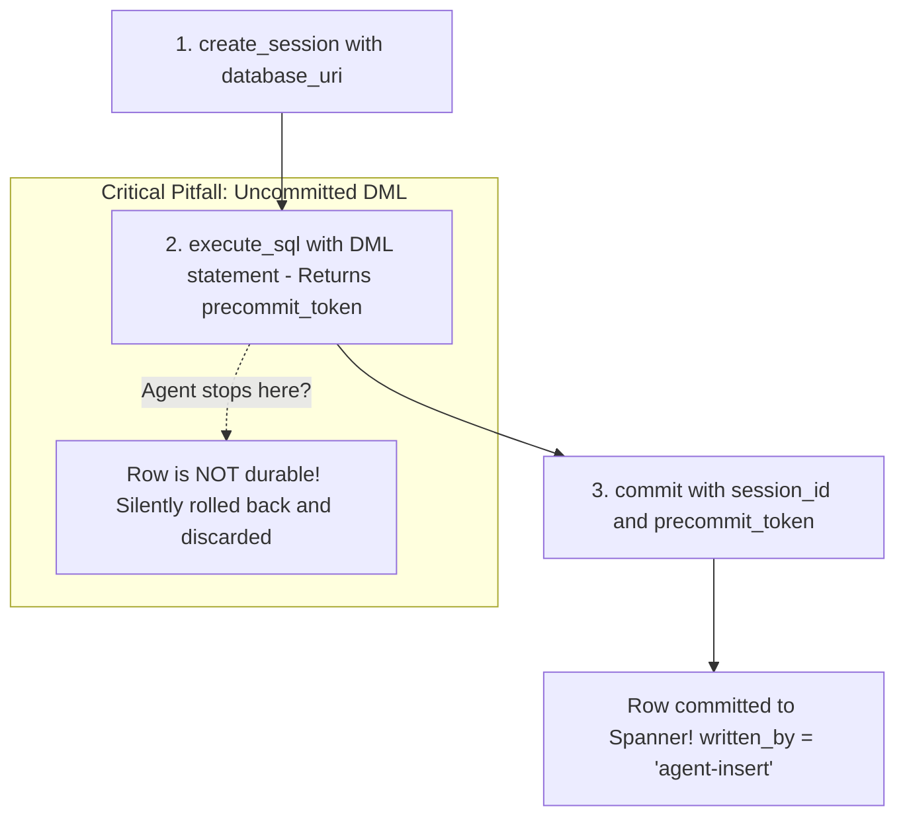
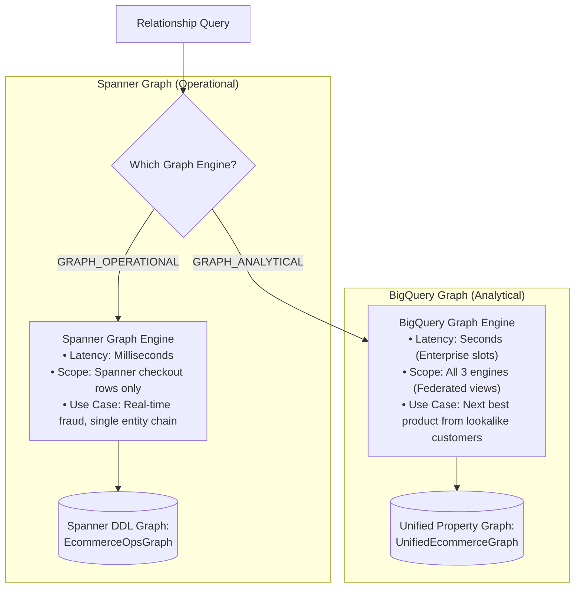

# 🌐 Lab 11: Agentic Data Cloud — Zero-ETL Federation across AlloyDB, Spanner & BigQuery

You finished Lab 10 with one database engine, one agent and two guarantees: the agent
could not invent a business definition, and it could not read a protected column.

This lab keeps both guarantees and adds the two things a real platform has that a
single dataset does not. **The same data lives in three different database engines / applications **, and **not every
agent is allowed to do the same things.**

Neither is achieved with a pipeline or a prompt. BigQuery reads the other two
engines live, at query time, with nothing copied. The agent boundary is IAM.

---

## 🚀 Quick Start: Environment & Project Setup

```bash
cd ~/labs/*agentic_data_cloud_zero_etl/assets
gcloud config set project <YOUR_PROJECT_ID>
ls
# verify.sh  init.sh  deploy.sh  whoami.sh  agent/  transact/  lab-runner/
```

Everything below runs from this directory.

---

## 🗺️ Lab Roadmap & Service Architecture

Every step starts with one badge saying where you work:
**🖥️ TERMINAL** (workstation shell and `agy`), **🌐 CONSOLE** (the lab console
web app, deployed in Step 6), or **🖥️→🌐 BOTH**.

| Steps | Where | What you are doing |
|---|---|---|
| 1–2 | 🖥️ TERMINAL | bootstrap, then meet the three engines |
| 3–5 | 🖥️ TERMINAL | the lab's actual work: three TODOs with `agy` |
| 6 | 🖥️→🌐 BOTH | deploy three Cloud Run services, open the console |
| 7–13 | 🌐 CONSOLE (11, 12: BOTH) | the demonstrations; read here, press buttons there |

This guide is the only set of instructions. The console has one screen per
browser step, titled with the same number and name as the step here, and it
only runs things and shows results. Its left-hand navigation shows the whole
route: console steps are links, terminal steps (1–5) are greyed out.

The console uses the same layout as the From Data to Agent console. Its top bar
has a lab switcher: if the **From Data to Agent** console is deployed in this
project, its tab opens it (for example to re-run an earlier demonstration);
otherwise the tab reads *not deployed yet*.

> [!NOTE]
> A few features used in this lab are in **Preview** (not yet GA). Always check
> the official product documentation and release notes for the current status.

### 🗺️ Reference Diagrams

Once the console is deployed in Step 6, its top bar has a **Reference diagrams**
link that opens in a separate browser tab:
* **Architecture & IAM**: Cloud Run services, identity boundaries, and network paths.
* **Multi-Engine Data Model**: which entities live in BigQuery, Spanner, or AlloyDB.
* **Agent Topology**: the 7 routing paths from the router to in-process and cross-service specialists.
* **Data Flow**: federated read paths vs. transactional commit write paths.
* **Recap: Lab 10 Foundation**: Lab 10's architecture and ERD, marked as prior work.

### 🛡️ Three Cloud Run Services & IAM Boundaries

Lab 10 had two: an agent and a lab runner, differing by service account, which is
how it proved that column masking is a property of identity rather than of code.

Lab 11 has three, for a sharper version of the same argument:

| Service | Runs as | Can it write? |
|---|---|---|
| **lab-runner** | `lab11-runner-sa` | no — reads everything a participant may read |
| **dispatch agent** | `lab11-dispatch-sa` | **no** — router, analyst and graph specialist |
| **transactional agent** | `lab11-transact-sa` | **yes**, AlloyDB and Spanner — and it cannot read BigQuery |


<details>
<summary><b>View Mermaid Source Code</b> (click to expand)</summary>

```mermaid
graph TD
    User([User / Browser]) -->|HTTP| Runner[lab-runner Service<br/>Identity: lab11-runner-sa<br/>Read-Only UI]
    Runner -->|HTTP| Dispatch[dispatch-agent Service<br/>Identity: lab11-dispatch-sa<br/>CANNOT WRITE]
    
    subgraph InProcess ["In-Process Specialists (Read-Only)"]
        Dispatch --> Router[Router: tools=[]]
        Router --> BQSpecialist[BigQuery Analyst]
        Router --> CatSpecialist[Catalog Specialist]
        Router --> GraphSpecialist[Graph Specialist]
    end
    
    subgraph CrossService ["Cross-Service Boundary (IAM Enforced)"]
        Router -->|HTTP + ID Token| Transact[transactional-agent Service<br/>Identity: lab11-transact-sa<br/>CAN WRITE]
    end
    
    BQSpecialist --> BigQuery[(BigQuery)]
    CatSpecialist --> Dataplex[(Dataplex)]
    Transact --> AlloyDB[(AlloyDB)]
    Transact --> Spanner[(Spanner)]
```
</details>

The reason this is three deployments and not one agent with five sub-agents is
worth stating plainly, because it is the single most useful architectural fact in
the lab: **ADK runs sub-agents in-process, and a process has exactly one service
account.** Two capabilities that must genuinely differ cannot live in one
service. So the router calls the write path over HTTP with an ID token, and the
write capability lives only in that second service's identity.

---

## 🏗️ Pre-provisioned Infrastructure & Data Topology

Terraform built all of this before you logged in:

* **Spanner** `zeroetl-ops` — ENTERPRISE, `us-central1`. Tables `Customers`,
  `Products`, `CustomerOrders` (interleaved), and the property graph
  `EcommerceOpsGraph`, all declared in the database DDL.
* **AlloyDB** `zeroetl-cluster` — `us-central1`, private IP. Tables `customers`,
  `products`, `orders`, created through the AlloyDB MCP server.
* **Two BigQuery connections** — one to AlloyDB (`google-alloydb` connector), one
  cloud-resource connection for Spanner.
* **Starter data in both operational engines** — AlloyDB and Spanner arrive
  already populated, as they would be in any environment where applications have
  been running. Terraform seeds them at setup time with two `EXPORT DATA`
  statements reading **Lab 10's `ecommerce_lab` tables**; that is environment
  setup, not part of the lab, and it is why those rows carry
  `written_by = 'reverse-etl-seed'`. Appendix C has the statements if you want
  them.

  The source matters more than it looks. An earlier version of this lab read
  `bigquery-public-data.thelook_ecommerce` directly and re-derived Lab 10's
  sample, which removed a dependency and broke the lab: **TheLook is
  regenerated.** Seeded two days apart, Lab 10's sample and Lab 11's shared
  **13 of 500 products**, and two thirds of the graph edges pointed at customer
  and product ids that were not in the node views — which a property graph does
  not report as an error. It simply returns fewer paths.

  "The same rows live in three engines" is the whole thesis here, so the source
  has to be the one copy that already exists.

* **No PII leaves the warehouse.** `email` is deliberately **not** copied. The
  AlloyDB and Spanner `customers` tables carry the column, and it is `NULL` in
  every row. That is a governance decision, not an oversight: the governed
  warehouse is where the PII lives and where the SENSITIVE policy tag applies,
  and the operational copies have no need of it. Look for yourself in Step 13 —
  a masking policy you can sidestep by copying the column elsewhere is not a
  control.
* **The federation** — an external dataset over Spanner, and the views
  `unified_orders`, `unified_customers`, `unified_products`,
  `unified_categories`, `unified_product_category`, `unified_order_edges` in
  `ecommerce_zeroetl`.
* **The unified property graph** `UnifiedEcommerceGraph`, declared over those
  views with Lab 10's vocabulary: `Customer`, `Product` and `Category` nodes,
  `PURCHASED` and `IN_CATEGORY` edges.
* **The data volume** is whatever Lab 10 seeded: about 1,000 customers and
  roughly 7.4k order items (6,000 of them Lab 10's synthetic co-purchase signal),
  present once in each engine. No number in this guide depends on the exact
  count.
* **Three service accounts** with deliberately different capabilities.

From Lab 10, unchanged and depended upon: the `ecommerce_lab` tables, the business
glossary, the SENSITIVE policy tag and its masking policy, and the ENTERPRISE
reservation that `GRAPH_TABLE` needs.

---

## 📋 Prerequisites & Day-0 Checks

A workstation terminal, `gcloud` signed in, and Lab 10 applied in the same
project. `verify.sh` checks all of it.

---

# 💻 PART 1: In Your Terminal (Building & Dispatching Agents)

## ⚡ Step 1: Bootstrap & Verify Day-0 Multi-Engine Infrastructure

**🖥️ TERMINAL**

### 🎯 What This Task Is About
> **Goal**: Initialize your shell environment, link cross-lab security tags, configure 4 remote MCP servers (`bigquery`, `dataplex`, `spanner`, `alloydb`), and run Day-0 smoke tests.
> * **Business Context**: Lab 11 reuses Lab 10's data warehouse and policy tags. Missing permissions fail silently as opaque Cloud Run runtime errors.
> * **Technical Mechanism**: `init.sh` writes MCP configs with your active project ID and links service accounts to Lab 10's `SENSITIVE` policy tag. `verify.sh` asserts row counts across all 3 engines.

```bash
bash init.sh
bash verify.sh
```

`init.sh` configures **four** MCP servers for `agy` — BigQuery, Knowledge Catalog,
Spanner and AlloyDB — and does two IAM grants that Terraform structurally cannot.
Both grants attach Lab 11's service accounts to *Lab 10's* policy tag, whose
resource name embeds a numeric id generated during Lab 10's apply; the Terraform
provider ships no data source that can look it up, and the scaffolding engine
gives Lab 11's module no way to order itself after Lab 10's. `init.sh` runs after
everything exists, on a machine where both are discoverable.

Read the `verify.sh` output rather than skimming it. It asserts **row counts**,
not the absence of errors, and the difference matters: a property graph declared
over empty tables answers successfully with nothing in it, and a federated view
over a failed export returns zero rows quite happily.

## 🔄 Step 2: Query Live Zero-ETL Federation Across 3 Engines

**🖥️ TERMINAL**

### 🎯 What This Task Is About
> **Goal**: Query `unified_orders` directly from BigQuery to see real-time data spanning BigQuery, Spanner, and AlloyDB with zero ETL pipelines and zero replication lag.
> * **Business Context**: Reconciling checkout engines with financial reporting usually requires complex batch or CDC pipelines that create data lag and discrepancies.
> * **Technical Mechanism**: BigQuery queries native storage, a Spanner external dataset, and an AlloyDB `EXTERNAL_QUERY` pushdown live at query time, tagging each row with `origin`.

**AlloyDB already holds this quarter's order corrections. Spanner already holds
live checkout transactions.** Neither was built by copying BigQuery: they are where
the applications that actually run this business write — checkout appends to
Spanner as orders are placed, a fraud-scoring service reads and writes AlloyDB.
BigQuery holds the governed warehouse you built in Lab 10 and has never seen the
other two.

Nothing reconciles them. There is no nightly load, no CDC stream, no replication
lag to reason about. The question this lab answers is what it takes to ask one
question across all three **without building any of that** — and the answer is that
BigQuery reads the other two live, at query time, with zero data movement.


<details>
<summary><b>View Mermaid Source Code</b> (click to expand)</summary>


</details>

```bash
bq query --use_legacy_sql=false --location=US "
SELECT origin, COUNT(*) AS rows
FROM \`$(gcloud config get-value project).ecommerce_zeroetl.unified_orders\`
GROUP BY origin ORDER BY origin"
```

Three origins, similar counts. Now look at *how* you got them: the BigQuery rows
came from a table, the Spanner rows through an external dataset, and the AlloyDB
rows through `EXTERNAL_QUERY`, which pushed a PostgreSQL statement down into
AlloyDB and returned the result. One query, three engines, nothing copied.

## 🧠 Step 3: Implement the 7-Way Intent Router (TODO_A)

**🖥️ TERMINAL**

### 🎯 What This Task Is About
> **Goal**: Author the classification instructions in `agent/router.py` to categorize user queries into 7 discrete intents without granting the router any tools.
> * **Business Context**: Misrouted reads yield wrong answers, but misrouted writes silently corrupt databases. Writes lacking an engine name must halt and clarify.
> * **Technical Mechanism**: An `LlmAgent` with `tools=[]` acting purely as a classifier, returning terminal `CLARIFY_ENGINE` whenever a write does not explicitly name AlloyDB or Spanner.

Open `agent/router.py`. The router is an `LlmAgent` with `tools=[]` — it
physically cannot call anything, so classification is all it can do. Your job is
its instruction: **seven categories**, and the rules for telling them apart.


<details>
<summary><b>View Mermaid Source Code</b> (click to expand)</summary>


</details>

| Category | When |
|---|---|
| `ANALYTICS` | revenue, totals, averages, counts — anything answered by aggregating |
| `CATALOG` | what a business term *means*; glossary lookups |
| `GRAPH_ANALYTICAL` | patterns across the population, or a recommendation for one customer that needs them — recommend, next best, lookalike customers, segments |
| `GRAPH_OPERATIONAL` | the live state, right now — this customer's order chain, or which orders are stuck in Processing at the moment |
| `TRANSACT_ALLOYDB` | a write, where the user **names** AlloyDB |
| `TRANSACT_SPANNER` | a write, where the user **names** Spanner |
| `CLARIFY_ENGINE` | a write is requested but **no engine is named**. Halt and ask. |

The genuinely hard distinctions:

* **ANALYTICS vs GRAPH_ANALYTICAL.** "Which products sell most" is an aggregate.
  "Which products are bought *together*" is a traversal. The test is whether the
  answer needs a relationship between two rows.
* **ANALYTICS vs GRAPH_OPERATIONAL.** Both can start with "which customers". The
  test is time: a read about what is true *right now* (stuck, open, currently)
  is `GRAPH_OPERATIONAL` even when it names no customer, because only the
  operational store sees a row the instant it commits. `ANALYTICS` aggregates
  history: revenue, totals, trends.
* **The two TRANSACT intents, and the third outcome.** A write goes to
  `TRANSACT_ALLOYDB` or `TRANSACT_SPANNER` **only** when the user names that
  engine. This next rule is not a design question for you to settle — it is
  required, and `dispatch.py` and `orchestrator.py` are already built around it:

  > If a write is requested and NO engine is named — *"create an order for
  > customer C042, product P015, $299"* — the answer is `CLARIFY_ENGINE`. Not a
  > guess, and not a refusal: a halt, followed by asking the user which engine to
  > write to.

  Do not infer the engine from anything except the user's own words. Not from
  which engine was used last, not from what the ids look like, not from a
  default. If it is not named, it is `CLARIFY_ENGINE`.

  **Why this one case is different.** Every other intent, guessed wrong, produces
  a wrong *answer* that the next question corrects. A write guessed wrong puts a
  real row in the wrong database: it appears in `unified_orders` under the wrong
  `origin`, the totals still reconcile, and nothing anywhere reports a problem.

  `CLARIFY_ENGINE` is a **classification, not a refusal**, and it applies to
  **writes only** — a read that names no engine is fine, because `ANALYTICS` and
  the graph intents choose their own source.

`-i` takes the very next argument as the prompt, so keep the prompt directly
after it and put any other flag before `-i`, never between `-i` and the prompt.

```bash
agy -i "In agent/router.py, replace the ROUTER_INSTRUCTION placeholder with
 the classification instruction for a seven-way intent router. The seven
 categories are ANALYTICS, CATALOG, GRAPH_ANALYTICAL, GRAPH_OPERATIONAL,
 TRANSACT_ALLOYDB, TRANSACT_SPANNER and CLARIFY_ENGINE. It must return only
 the category name, must distinguish aggregation from traversal,
 population from single entity, and history from right now (a read about
 what is stuck or open right now is GRAPH_OPERATIONAL, even with no customer
 named), and must return CLARIFY_ENGINE whenever a
 write is requested without the user naming AlloyDB or Spanner -- never
 guessing an engine and never inferring one from context or defaults.
 CLARIFY_ENGINE applies to writes only. Do not add tools and do not add
 sub_agents."
```

The same prompt is in the file's TODO_A comment block. Then check your work:

```bash
grep -A 3 "ROUTER_INSTRUCTION = " agent/router.py | head -5
```

Check that `tools=[]` is still `tools=[]`. If `agy` "helpfully" gave the router a
tool, the whole design is gone — the router can now answer questions itself, and
routing becomes a negotiation between the model and the prompt.

## 🔀 Step 4: Wire the Cross-Service Dispatch Table (TODO_B)

**🖥️ TERMINAL**

### 🎯 What This Task Is About
> **Goal**: Add missing transaction intents (`TRANSACT_ALLOYDB` and `TRANSACT_SPANNER`) to `_INTENT_TO_SPECIALIST` in `agent/orchestrator.py`.
> * **Business Context**: When routing fails, code-level dictionary lookups fail deterministically with a `KeyError` rather than guessing or silently hallucinating actions.
> * **Technical Mechanism**: The dispatch table routes read intents locally in-process, but dispatches write intents over authenticated HTTP to a dedicated transactional service.

Open `agent/orchestrator.py`. Four intents are wired; the two that write are not.
Add them.

Before you do, read `remote_transact.py`. Those two agents are unlike the other
four: every specialist in that dict runs **in this process**, as
`lab11-dispatch-sa`, which holds no write role anywhere. The two you are adding
are HTTP calls to a second service running as a different account. That hop is
the only reason a write can happen at all.

Then notice what happens when routing is wrong. An unmapped intent produces a
named error and stops. Compare that with a prompt-routed system, where a
mis-route produces a confident answer from the wrong agent and nothing anywhere
reports a problem.

```bash
agy -i "In agent/orchestrator.py, add the two missing entries to
 _INTENT_TO_SPECIALIST: TRANSACT_ALLOYDB maps to alloydb_transact_agent and
 TRANSACT_SPANNER maps to spanner_transact_agent. Both are already
 imported. Do not change any other entry and do not add routing logic to
 the router's instruction."
```

The same prompt is in the file's TODO_B comment block. Then check your work:

```bash
grep -A 8 "_INTENT_TO_SPECIALIST" agent/orchestrator.py | head -10
```

## 💾 Step 5: Implement 2-Phase Spanner Transactional Writes (TODO_C)

**🖥️ TERMINAL**

### 🎯 What This Task Is About
> **Goal**: Author the system instruction in `transact/spanner_specialist.py` enforcing two-phase commit via the Spanner MCP server.
> * **Business Context**: An agent stopping after `execute_sql` reports phantom success while committing zero rows to storage—silently dropping customer orders.
> * **Technical Mechanism**: Enforce the mandatory 3-call sequence: `create_session` -> `execute_sql` (returning `precommit_token`) -> `commit` with the token.

Open `transact/spanner_specialist.py`. The toolset is wired; the instruction is
yours, and it is the hardest of the three because it has to carry a fact that is
easy to state and easy to omit:

**On the Spanner MCP server, a DML statement is not durable when `execute_sql`
returns.** It returns a `precommit_token`, and `commit` must be called with it.
An agent that stops after `execute_sql` reports success and writes nothing. When
the federation proof in Step 9 shows an unchanged row count, this is almost
always why.


<details>
<summary><b>View Mermaid Source Code</b> (click to expand)</summary>


</details>

```bash
agy -i "In transact/spanner_specialist.py, replace the SPANNER_INSTRUCTION
 placeholder. The agent reads and writes the Spanner database
 {DATABASE_URI} through the Spanner MCP server. It must: pass that database
 on every call; perform DML as create_session then execute_sql then commit
 with the returned precommit_token, and never claim success before the
 commit; know that CustomerOrders is interleaved in Customers with primary
 key (customer_id, order_item_id) and that all ids are STRING; set
 written_by='agent-insert' on every row it writes; set status to one of
 Complete, Shipped, Processing, Cancelled, Returned (default Complete);
 generate ids in the INSERT with CONCAT('agent-', GENERATE_UUID()) and
 THEN RETURN order_item_id, order_id; and choose GQL over
 EcommerceOpsGraph for relationship questions versus plain SQL for row
 questions, stating which it used. Do not add tools."
```

The full requirements are in the TODO_C comment block. Note the schema surprise
too: `CustomerOrders` is interleaved in `Customers`, so its primary key is
`(customer_id, order_item_id)` — customer first — and an `INSERT` missing
`customer_id` fails with an error about a key column that never mentions
interleaving.

Two values the model will otherwise make up: `status` and the ids. Left alone
it writes `status = 'Pending'`, which is not an Order Status value in Lab 10's
glossary, so every governed query (`status = 'Complete'`, …) silently skips the
row. And an id like `ord-<customer>-<product>` collides the second time the
same customer orders the same product. A timestamp the model "generates" is no
better: it does not know the current time, so two orders get the same invented
value. Let Spanner generate the id (`GENERATE_UUID()`) and read it back with
`THEN RETURN`.

## 🚀 Step 6: Deploy the 3 Multi-Identity Services to Cloud Run

**🖥️→🌐 BOTH**

### 🎯 What This Task Is About
> **Goal**: Build container images and deploy the lab console (`lab-runner`), `dispatch-agent`, and `transact-service` across their three distinct service accounts.
> * **Business Context**: Security boundaries cannot rely on prompts or code filters alone; least-privilege service accounts ensure unauthorized writes are rejected at the GCP IAM level.
> * **Technical Mechanism**: Execute `bash deploy.sh` to run parallel Cloud Build jobs and configure Cloud Run services with `run.invoker` cross-service authorization.

**a. 🖥️ Terminal: deploy.**

```bash
bash deploy.sh
```

The order is a chain, not a preference: **transact** first (it has no
dependencies), then **agent** (it needs the transact URL), then **runner** (it
needs the agent URL). `deploy.sh` refuses to build if a TODO is still a
placeholder — a five-minute build that fails at runtime is a bad way to learn you
missed one.

```bash
bash whoami.sh
```

Three services, three identities, and one line each on what they cannot do.

**b. 🖥️→🌐 Switch to the lab console.** Copy the console URL from the last
lines of the `deploy.sh` output and open it in a new browser tab. Keep that tab
next to your workstation: from here on you read each step in this guide, press
its buttons in the console, and come back here for what the result means.

> [!NOTE]
> The console URL is public so it opens without extra setup. Anyone with the URL
> can press its buttons, including the Step 8 write, in this sandbox project; do
> not share it.

*(Lost the URL? `gcloud run services describe lab11-runner --region us-central1 --format "value(status.url)"`)*

**c. 🌐 Console: the Step 6 screen.** Press **Check both services are healthy**. Both services should return JSON rather than an error.

---

# 🌐 PART 2: In the Lab Console (Testing Governance & Federation)

**How to work through Part 2.** This guide stays your script; the console only
runs things and shows results.

1. Read the step here first.
2. Open the console screen with the **same step number** (left-hand
   navigation) and press the buttons this guide names, in the order it names
   them.
3. Come back here for what the result means.

Steps 7–10 and 13 happen entirely in the console. Steps 11 and 12 switch
between the two, and every sub-step says where it happens:

| Marker in this guide | Where | What the console shows |
|---|---|---|
| **🌐 Console** | the lab console tab | the button to press |
| **🖥️ Terminal** | your workstation terminal | a yellow **🖥️ In your terminal** box naming this sub-step: do it there, then return to the console for the next button |

Greyed-out steps in the console's navigation are terminal-only steps; they have
no screen. The **ⓘ** next to a button shows which identity runs it and whether
it changes data.

> [!TIP]
> The **Reference diagrams** link in the console's top bar opens architecture,
> data model, data flow and agent topology diagrams in a separate browser tab.
> Keep it open to check which engine holds what, or which identity can write.

## 📊 Step 7: Live Query Resolution Across 3 Engines

**🌐 CONSOLE**

### 🎯 What This Task Is About
> **Goal**: Query `unified_orders` and ask the agent the same question, verifying origin-tagging and read-only routing.
> * **Business Context**: Someone has to answer "how many orders are there" without first asking which system to trust. The usual answer is a warehouse load, and it is stale by definition.
> * **Technical Mechanism**: `unified_orders` is a view: BigQuery reads its own table, reaches Spanner through an external dataset, and pushes SQL into AlloyDB with `EXTERNAL_QUERY`. The router classifies aggregation queries as `ANALYTICS` and dispatches them to the read-only analyst.

Press **Query the unified view**. The coloured chips above the table count the
rows each engine served.

Two columns do two different jobs:

* **`origin`** is *which engine served this row*, a property of the federation.
* **`written_by`** is *who put it there*: `'reverse-etl-seed'` on every row that
  was already in the operational stores when you arrived, `'agent-insert'` on
  anything an agent writes during this lab.

Keeping them apart is what lets you find your own row among thousands of
seeded rows in Step 8.

Then press **Ask the agent** and read the **router** line above the answer. The
intent is `ANALYTICS`, so the question went to the read-only analyst, which
holds no write role on any engine and could not have changed a row even if the
question had asked it to.

## ✍️ Step 8: Execute Cross-Identity Transactional Writes

**🌐 CONSOLE**

### 🎯 What This Task Is About
> **Goal**: Command the agent to write a customer order, observing how the dispatch router forwards requests across IAM boundaries to the transactional service.
> * **Business Context**: An order written to the wrong database is a real row that reconciles cleanly under the wrong `origin`, and nothing reports it. The control has to hold when the agent's prompt is subverted, not only when it is followed.
> * **Technical Mechanism**: The read agent runs as `lab11-dispatch-sa`, which holds no write role on either engine. `TRANSACT_*` dispatches over HTTP with an ID token to a second Cloud Run service running as `lab11-transact-sa`, which tags inserted rows with `written_by = 'agent-insert'`.

1. Press **Find a customer and a product I can use**, then **Use** on any row.
   The agent refuses to invent foreign keys, and it is right to.
2. Pick an engine and press **Ask the agent to write**. The console only accepts
   ids that exist in BigQuery and an amount between 1 and 10,000.
3. Read the **router** line. The intent is `TRANSACT_SPANNER` or
   `TRANSACT_ALLOYDB`, decided by a dict lookup in code rather than by a model
   choosing a hand-off, and the specialist named there lives in the *other*
   service, under the *other* identity.
4. Press **Find agent-written rows in unified_orders**.

That row was written by an agent into an operational database, and you are
reading it in BigQuery. Nothing synchronised the two, and no job ran between the
write and this query. The `origin` column names the engine that still
physically holds the row, and federation fetched it when you pressed the button.

If the agent reported success and no row appears on Spanner, the DML was almost
certainly never committed: `execute_sql` returns a `precommit_token`, and the
commit is a separate call (Step 5, TODO_C).

## ⏱️ Step 9: Benchmark Zero-ETL Federation Latency & Overhead

**🌐 CONSOLE**

### 🎯 What This Task Is About
> **Goal**: Prove that a write becomes visible through federation immediately, then measure where the latency of a federated query actually goes.
> * **Business Context**: "Real-time" is the word that gets a design approved. Before anyone commits to it in a customer conversation, it needs a number attached.
> * **Technical Mechanism**: A before/after row count around an agent write, then a 16-query benchmark comparing `SELECT 1`, a local BigQuery scan, single-row and all-row federated reads, and a 3-way engine union.

### Part A: the timed proof

Press **Run the timed proof**. It counts the Spanner rows visible in BigQuery,
has the agent write one row to Spanner, and counts again. The **Delta** tile
should read **+1**.

The row became visible in the time it took to re-run one query. Nothing was
scheduled, nothing was copied, and no freshness window was involved: the
external dataset reads Spanner *at query time*. This is the difference between
federation and replication, and it is why "stale" does not apply.

If the delta is 0, the write was never committed. See Step 5.

### Part B: where those seconds actually go

Part A is easy to read as *federation is free*. It is not: it moves the cost
rather than removing it, and this measurement shows where the cost sits.

Press **Measure the breakdown**. It runs **16 queries** (five measurements, each
a median of three, plus a discarded warm-up, with the result cache disabled)
and takes **about a minute**. The five measurements are cumulative:
`SELECT 1` touching no table, a local `COUNT(*)`, a federated read of **one**
row, a federated read of **all** rows, and finally all three engines at once.

Three findings come out of it, and none is what people expect:

* **Roughly a second is not federation at all.** `SELECT 1` pays it too; that is
  BigQuery's own job submission and result fetch. Attributing it to federation
  is the most common way a benchmark like this gets misread.
* **The cost is per-QUERY, not per-row.** One row and every row (several
  thousand) cost almost the same. The **Cost of every other row** tile will most
  likely read *below noise*. That is the finding, not a broken measurement: at this data size the
  transfer is invisible next to the setup.
* **Three engines cost about what one does.** The arms of the union run
  concurrently: you pay for the slowest, not the sum.

<details>
<summary><b>What consumes those seconds, underneath</b> (click to expand)</summary>

Three layers, paid in this order. Only the middle one is federation.

**a. BigQuery job lifecycle: the floor, ~2s.**
Creating a query job is a REST call. BigQuery admits the job, plans it,
schedules it onto slots, runs it, then the client polls for completion and
fetches results. `SELECT 1` pays all of that and touches no data. Every BigQuery
query pays it, federated or not.

**b. Crossing the boundary: the actual federation cost, ~1.5s.**
This is what federation adds, and it is a fixed setup cost:

* the connection's service account authenticates to Spanner over IAM, and the
  channel is established with mTLS;
* BigQuery fetches the external table's schema. It does not keep a copy, which
  is exactly why the data is never stale;
* the read is planned as a **Data Boost** request: Spanner partitions the query
  and serverless compute is provisioned to serve it.

None of that scales with how many rows you asked for. That is why one row and
several thousand rows cost almost the same.

**c. Moving the data: the only part that scales.**
Rows are scanned by Data Boost, serialised, and streamed back into BigQuery's
execution. At this lab's size (a few thousand rows) it takes under a second. At 50 million
rows it would dominate.

**What "no freshness window" really costs.** Replication pays once, at write
time, and then every read is fast. Federation pays (b) on **every query**, and
in exchange never serves a stale row. That is a good trade for an ad-hoc
question spanning three engines, and a bad one for a dashboard refreshing every
few seconds.

</details>

<details>
<summary><b>How it could be made faster, by layer</b> (click to expand)</summary>

**Spanner side**

* **Data Boost is already doing the most important thing.** It runs the read on
  independent serverless compute, so a federated analytical scan does not take
  CPU from live transactions. It is why this lab grants
  `roles/spanner.databaseReaderWithDataBoost`; plain `databaseReader` is refused.
* **Adding processing units will NOT speed these reads up.** Data Boost compute
  is separate from the instance's serving capacity. Scaling the instance is the
  intuitive move and the wrong one.
* **Index for the predicates you actually federate on**, so pushdown scans less.
  This lab ships `CustomerOrdersByProduct` for that reason.
* **Interleaving helps entity-scoped reads.** `CustomerOrders` is interleaved in
  `Customers`, so one customer's rows sit in one split.

**BigQuery side**

* **Push work down, do not pull it up.** For AlloyDB the inner SQL of
  `EXTERNAL_QUERY` is executed *by AlloyDB*: put the `WHERE` and the aggregation
  inside it.
* **Never `SELECT *` across a federated arm.** Every column is serialised and
  moved.
* **Batch. Never federate in a loop.** The setup cost is per query, so 100 small
  federated lookups cost roughly 100 × 1.5s. One query with an `IN` list pays it
  once.
* **Let the result cache work.** These measurements disable it. A repeated
  identical query normally returns from cache almost instantly, but the cached
  answer is a snapshot, so you have traded back the freshness you came for.
* **Materialise when freshness is not the requirement.** A scheduled query
  writing a native table turns a ~4s federated read into a sub-second one.

**Architecture side**

* **Co-locate.** BigQuery federation matches by *geography*: a US multi-region
  job may read a Spanner or AlloyDB instance in any US region. Crossing
  geographies adds latency, and mismatching them fails outright.
* **Pick the mechanism for the access pattern.** Federation is for ad-hoc,
  low-frequency, cross-engine questions. For a dashboard hitting the same query
  every few seconds, stream instead (Spanner change streams into BigQuery, or
  Datastream for AlloyDB) and read a native table.
* **Reservations affect throughput, not this floor.** The Enterprise
  reservation is about slot availability and graph queries; it does not shrink
  the per-query setup cost.

**Summary:** you cannot make federation much faster per query, because the cost
is setup, not volume. You make it faster by calling it **less often**, or you
decide the freshness is not worth it and copy the data instead.

</details>

## 🕸️ Step 10: Operational (Spanner) vs. Analytical (BigQuery) Graph Engines

**🌐 CONSOLE**

### 🎯 What This Task Is About
> **Goal**: Ask two questions about the **same at-risk customer** — one operational on Spanner Graph, one analytical on BigQuery Graph — and see why they belong to different engines.
> * **Business Context**: Lab 10 ended with a support lead asking *"This customer just returned their last order. What should we offer them next?"* Before answering, the same lead wants to know *what that customer just did*. The first question is about one customer, right now. The second is about everyone who resembles them, across every system that records purchases.
> * **Technical Mechanism**: Spanner Graph traverses Spanner's own tables in milliseconds and sees Spanner rows only. BigQuery Graph traverses the federated views in seconds, sees all three engines, and needs the Enterprise reservation. `UnifiedEcommerceGraph` now uses Lab 10's vocabulary (`Customer`, `Product`, `Category`, `PURCHASED`, `IN_CATEGORY`), so Lab 10's query runs on it with only the graph name changed.

Spanner Graph is milliseconds, transactional, and sees Spanner rows only.
BigQuery Graph is seconds, historical, and sees all three engines because
it is declared over the federated views. Neither is better; they answer
different questions.

**At risk means one thing in both labs:** the customer's **latest** order item
is `Returned` or `Cancelled`. The agent's older "problem purchases" query
(any item `Processing`, `Returned` or `Cancelled`) is a different set, so it is
now labelled **open or reversed orders**.

1. **Pick an at-risk customer.** Press **Find at-risk customers**. The chips are
   resolved exactly as in Lab 10, except that "latest order item" is read from
   `unified_orders`, so a status the agent changed in Spanner or AlloyDB counts.
   Only a customer the server itself resolved can be sent back, and the id
   reaches both engines as a query parameter.
2. **Operational: what did this customer just do?** Press **Read the live order
   chain**. The console runs one GQL traversal on Spanner in a read-only
   snapshot:

   ```sql
   -- Spanner Graph (operational), run by the console as lab11-runner-sa
   GRAPH EcommerceOpsGraph
   MATCH (c:Customer)-[:PLACED]->(o:CustomerOrder)-[:HAS_ITEM]->(p:Product)
   WHERE c.customer_id = @cid
   RETURN o.order_item_id, o.order_id, o.status, o.order_date, p.name, o.written_by
   ORDER BY order_date DESC, order_item_id DESC
   LIMIT 20
   ```

   Note the wall clock: milliseconds, because `CustomerOrders` is interleaved in
   `Customers` and one customer's rows sit in one split. **One `CustomerOrder`
   node is one order *item*, not one order**: its key is
   `(customer_id, order_item_id)`, the same grain as Lab 10's `PURCHASED` edge.
   A basket of three items is three `CustomerOrder` nodes sharing one
   `order_id`. The name is kept because `ORDER`, `INCLUDES` and `CONTAINS` are
   reserved in a `LABEL` clause, and the parse error they cause points at the
   surrounding syntax, never at the word.
3. **Analytical: what should we offer them?** Press **Recommend across three
   engines**. This is Lab 10's next-best-product query, character for character,
   with `ecommerce_graph_lab.ecommerce` replaced by `UnifiedEcommerceGraph`:

   ```sql
   -- BigQuery Graph (analytical): the same pattern as Lab 10 Step 9
   MATCH (me:Customer)-[:PURCHASED]->(s:Product)<-[:PURCHASED]-(peer:Customer)
         -[:PURCHASED]->(rec:Product)-[:IN_CATEGORY]->(cat:Category)
   WHERE me.customer_id = @cid AND peer.customer_id <> me.customer_id
     AND NOT EXISTS { MATCH (m2:Customer)-[:PURCHASED]->(r2:Product)
                      WHERE m2.customer_id = me.customer_id AND r2.product_id = rec.product_id }
   ```

   The elapsed time is seconds, not milliseconds: every `PURCHASED` hop reads
   the federated edge view, which reaches Spanner and AlloyDB at query time. The
   ego graph is Lab 10's widget. Seeded purchases are held by every engine and
   stay neutral; an edge that only **one** engine holds takes that engine's
   colour. A purchase the agent wrote to Spanner in Step 8 shows up this way if
   it falls inside this customer's neighbourhood, with no pipeline in between.
   Hover an edge to see which engines hold it.
4. **The dedup trap, side by side.** Press **Count paths vs count purchases**.
   Both columns run the query from card 3; the left one has its two `DISTINCT`s
   removed. Neither query errors. On this graph every seeded purchase is an edge
   **once per engine**, so each of the three `PURCHASED` hops matches three
   times, and a path count multiplies with every hop (on top of any product a
   customer bought more than once). The left-hand scores are inflated by orders
   of magnitude, the "≥ 2 shared products" threshold stops meaning anything, and
   the ranking changes. The right-hand column counts each product and each peer
   once, however many engines hold the purchase, and returns the same top 5 as
   Lab 10 did on its single-source graph. The two `DISTINCT`s were in Lab 10's
   query all along; this graph is where they earn their place.
5. **Let the agent choose the engine.** Press **Ask something operational**,
   then **Ask for both engines**, and compare the router lines and the
   latencies the agent reports. Then press **Ask for a recommendation**: the
   agent receives the customer you picked and calls
   `recommend_next_best_products(customer_id)`. That tool runs the same GQL as
   card 3, so its top five must match the card. If they differ, one side was
   edited; a unit test (`tests/test_lab11_agent_graph.py`) fails when the two
   queries drift apart.

   The graph specialist has four tools, and its model picks one from their
   descriptions:

   | Tool | Engine | Answers |
   | :--- | :--- | :--- |
   | `query_spanner_graph` | Spanner | customers with orders in `Processing` right now |
   | `query_bigquery_graph` | BigQuery, 3 engines | open or reversed orders by segment and origin |
   | `recommend_next_best_products` | BigQuery, 3 engines | next best product for one customer, via lookalike peers |
   | `query_both_graph_engines` | both | the Spanner and segment answers side by side, with latencies |

   A recommendation for one customer goes to BigQuery even though it names a
   single entity: the lookalike peers come from the whole population, across
   all three engines. `parse_graph_intent` encodes the same decision as a
   keyword classifier you can test in code.

This query has two layers, and the split is required: `GRAPH_TABLE` does the
pattern matching and returns a flat rowset, and the outer `SELECT` aggregates
it. Pushing the aggregation inside `GRAPH_TABLE` is the most common way this
query fails to compile.

If a traversal fails mentioning a reservation, the Enterprise reservation from
Lab 10 is still propagating; wait a minute. If it fails saying the graph does
not exist, or that the label `Category` is unknown, open **Recovery** on the
console screen and press **Declare the unified property graph**. Terraform
tolerates failure when declaring it because the graph depends on two
connections and two remote engines being reachable. Re-declaring is idempotent,
and the console's identity holds `bigquery.dataEditor` on the zero-ETL dataset
only.


<details>
<summary><b>View Mermaid Source Code</b> (click to expand)</summary>


</details>

### The trap under the unified graph

The node views deduplicate; only the **edge** view is a `UNION ALL`, and its key
is `edge_id = CONCAT(origin, '#', order_item_id)`.

The reason matters. The same customers exist in all three engines. A
`UNION ALL` of customer views would repeat every `customer_id` three times, and
BigQuery Graph does **not** reject a duplicated node key. It returns three times
as many paths, nine times as many on a two-hop traversal, and no error at any
point. It is the same class of failure as Lab 10's `order_id` versus
`order_item_id`: plausible wrong numbers, silently.

## 🛡️ Step 11: Stress-Test Security & Multi-Layer IAM Boundaries

**🖥️→🌐 BOTH**

### 🎯 What This Task Is About
> **Goal**: Test three security refusal layers: model rejection, MCP tool filtering, and GCP IAM enforcement.
> * **Business Context**: A security review does not ask whether the agent refuses. It asks what happens when the prompt is hostile, the model is wrong, and the tool filter has been edited by someone in a hurry.
> * **Technical Mechanism**: Prompt-level refusal (rephrasing can bypass it), `tool_filter` (the tool is absent from the function declarations), and IAM (the call is rejected by BigQuery).

1. **🌐 Console:** under **Ask the read-only analyst to write**, press **Try it**.
   Two independent walls stop it: `execute_sql` is not in the analyst's
   `tool_filter`, so the model is never shown a tool that can write, and
   `lab11-dispatch-sa` holds only `bigquery.dataViewer`, so hand-crafted DML
   would be refused by BigQuery itself. The first stops it asking; the second
   stops it succeeding.
2. **🌐 Console:** press **Check both services**. On the dispatch service, look at
   `wired_intents`: if `TRANSACT_ALLOYDB` and `TRANSACT_SPANNER` are missing,
   TODO_B is unfinished and every write request stops at the orchestrator with
   a named error rather than being handled by the wrong agent. The
   transactional service holds **no BigQuery data role at all**, so the blast
   radius of a compromised write agent stops at the two operational tables it
   was granted.

Three refusals, three different mechanisms, and telling them apart is the point:

| Source | What it means | What changes it |
|---|---|---|
| the model | it decided not to | rephrasing might |
| a `tool_filter` | the tool was never advertised | editing the filter; rephrasing cannot |
| IAM | denied after the request left the model | nothing about the conversation |

Only the third is a guarantee. This lab is built so the important ones are all of
the third kind.

## 🔒 Step 12: Re-verify Knowledge Catalog Grounding

**🖥️→🌐 BOTH**

### 🎯 What This Task Is About
> **Goal**: Re-verify that Lab 10's Knowledge Catalog grounding still holds in the multi-agent architecture.
> * **Business Context**: The revenue rule you proved in Lab 10 is the one finance depends on. Adding four specialists and a second service must not quietly move where that rule is enforced.
> * **Technical Mechanism**: The question now goes through a router and a CATALOG specialist, but grounding still resolves through the same scoped `search_entries`, a local function rather than the MCP tool of that name, which would search every project the caller can read.

This is Lab 10's demonstration, re-run against the new architecture, to answer
a fair question: did adding four specialists and a second service dilute what
Lab 10 established?

1. **🌐 Console:** press **Show the two numbers**. "Revenue" is not a column; it is
   a business rule in the Knowledge Catalog glossary, and the **Overstatement**
   tile shows how far off an agent is when it guesses. One missing `WHERE`
   clause produces a number that is not malformed, only plausible. Nothing
   surfaces as failed, which is what makes an ungrounded agent worse than a
   broken one.
2. **🌐 Console:** press **Ask for revenue by origin**. The **tools** trace should
   show `search_entries` *before* `execute_sql_readonly`. That order is the
   grounding: definition first, SQL second.
3. **🖥️ Terminal:** take the definition away:

   ```bash
   agy -i "Delete the glossary term 'Revenue' from the ecommerce-business-terms
    glossary in this project, then confirm it is gone."
   ```

   > [!NOTE]
   > **Wait for the search index before asking again.** The agent finds terms
   > through Knowledge Catalog *search*, and search picks up a glossary change
   > **anywhere from under a minute to about 5 minutes** after `gcloud` returns.
   > Ask too early and the agent still finds the deleted term and answers as if
   > nothing happened. Check the change has landed first:
   > ```bash
   > P="$(gcloud config get-value project)"; gcloud dataplex entries search "Revenue" --project="${P}" --scope="projects/${P}" --format="value(dataplexEntry.entrySource.displayName,entrySource.displayName)"
   > ```
   > Press the button again when Revenue no longer appears in the results.

4. **🌐 Console:** press **Ask for revenue by origin** again. The agent should
   stop and say the term has no governed definition, not fall back on a
   plausible guess.
5. **🖥️ Terminal:** restore the term with its original definition. Do not skip
   this: the term is Lab 10's, shared by this project, and Lab 10's console
   Step 7 depends on it too.

   ```bash
   agy -i "Restore the Revenue term in ecommerce-business-terms with description: Total revenue is calculated as SUM(total_amount) from the orders table WHERE status = 'Complete'. Orders in any other state are excluded. The permitted state values and their exact casing are defined by the Order Status term, not here."
   ```

   The same search lag applies: run the check command above until Revenue
   appears again before you rely on the term, here or in Lab 10's console.

The routing changed. The grounding did not.

## 🔐 Step 13: Re-verify PII Column Masking

**🌐 CONSOLE**

### 🎯 What This Task Is About
> **Goal**: Re-verify that BigQuery column-level masking on `customers.email` holds across three identities.
> * **Business Context**: The PII exposure you closed in Lab 10 has to stay closed now that two more engines hold a copy of the customer table and a second identity can write.
> * **Technical Mechanism**: The operational copies carry `email` as NULL by design, and in BigQuery the SENSITIVE policy tag resolves per identity before rows leave the engine, so the mask cannot be sidestepped by reading the column somewhere else.

`customers.email` carries the SENSITIVE policy tag. Same table, same column,
same SQL, and three different outcomes depending on who asks:

1. Press **Read the column as this console**. The console runs as
   `lab11-runner-sa`, which holds Fine-Grained Reader, so it sees real
   addresses.
2. Press **Ask the agent**. The dispatch agent holds Masked Reader and sees
   `XXXXX@domain`. It should say plainly that the value is masked rather than
   presenting `XXXXX@` as a real address.
3. Under **Try to argue with it**, press **Try it**. Nothing about the request
   reaches the decision: the masking is applied by BigQuery, per identity, on
   the way out of the engine, after the model has stopped being involved.

That is what "the guardrail lives in the platform" means when it is structural
rather than asserted.

---

## 🏁 Architecture Recap: What You Built

* A live federated view spanning three engines, tagged by origin, that reads
  every one of them at query time.
* Two property graphs over the same entities, chosen per question.
* A **seven-category** router with **no tools**, dispatching six of them through a
  dict and halting on the seventh.
* Three identities whose capabilities differ, enforced by IAM and by a network
  boundary rather than by instructions.

## 🛡️ Summary: What You Proved

**Federation is not a category of infrastructure; it is a view.** Answering one
question across three engines needed no pipeline, no CDC stream and no load
window — an external dataset, an `EXTERNAL_QUERY`, and a `UNION ALL` that resolves
when you run it. The engines were never synchronised because they never had to be.

**The agent boundary is IAM.** "This agent cannot write" is only true if it is
true when the agent's code is wrong, its prompt is subverted and its tool filter
is edited. That requires a second identity, which requires a second deployment.

---

## 🎯 Advanced Challenges (Open-Ended)

1. **Add a third write engine.** Cloud SQL federates the same way. How much of
   the router, the dispatch table and the unified view has to change? (Answer:
   one intent, one dict entry, one `UNION ALL` arm — which is the point.)
2. **Make the router report confidence** and route low-confidence queries to a
   clarifying agent instead of guessing.
3. **Break the graph on purpose.** Change `unified_customers` to a three-way
   `UNION ALL` and re-run Step 10. Note that no error appears and every number
   triples.
4. **Put the saga back.** Demo 2's `SagaCoordinator` chains two specialists with
   compensating actions. A cross-engine write — AlloyDB *and* Spanner, or neither
   — is the natural next lesson.

---

## 📚 Appendix A: Lab File Map

```
verify.sh   init.sh   deploy.sh   whoami.sh
agent/         dispatch service — router.py (TODO_A), orchestrator.py (TODO_B),
               dispatch.py, bq_analyst.py, catalog_specialist.py,
               graph_specialist.py, remote_transact.py
transact/      write service   — spanner_specialist.py (TODO_C), alloydb_specialist.py
lab-runner/    the lab console (FastAPI) — one screen per browser step, 6–13
               main.py        SCREENS registry: step numbers + titles, which
                              must match this guide's headings
               actions.py     one function per button; fixed SQL and prompts
               graph_story.py seed-customer validation + ego-graph builder,
                              byte-identical to Lab 10's copy
               templates/     one step_N.html per screen
               diagrams.html  Reference diagrams (top-bar link). Five diagrams
                              covering this lab and Lab 10. Nothing to run.
```

## 📚 Appendix B: Release Status

A few features used in this lab are not yet generally available (GA) and are
in **Preview**. Release status changes over time, so it is not listed here.
Before you recommend any part of this architecture, check the official product
documentation and release notes for BigQuery, Spanner, AlloyDB, the Knowledge
Catalog and their remote MCP servers for the current status, SLA and terms.

## Appendix C: How the operational stores were seeded

Nothing in the lab depends on this, and no step asks you to run it. It is here
because an engineer looking at `written_by = 'reverse-etl-seed'` deserves to find
the real answer rather than infer one.

AlloyDB and Spanner are presented throughout as engines the applications already
write to, which is how they would have been filled in any real environment. In
this environment Terraform filled them at setup time, with the two `EXPORT DATA`
statements below, reading Lab 10's `ecommerce_lab` tables. That is environment
provisioning, not a step in this lab — the same treatment Lab 10 gives its own
seeding from TheLook.

These are the statements Terraform ran before you logged in. They are reproduced
here rather than pointed at with a command, because **`infra/` does not ship to
your workstation** — the bootstrapper copies the lab's `assets/` and deliberately
excludes the Terraform. There is no file here to grep.

**Reference only. Do not run these.** They ran once, before you arrived, and
re-running one by hand would re-seed a table underneath the rest of the lab.

Into Spanner — `format = 'CLOUD_SPANNER'`, and the uri is the **API endpoint**,
not the `google-cloudspanner:/` form used for external datasets further down:

```sql
EXPORT DATA OPTIONS (
  uri             = 'https://spanner.googleapis.com/projects/PROJECT/instances/zeroetl-ops/databases/ecommerce-operational',
  format          = 'CLOUD_SPANNER',
  spanner_options = '{"table": "Products"}'
) AS
SELECT product_id, name, category, price FROM sample_products;
```

Into AlloyDB — three differences, each of which fails with its own unhelpful
error if you get it wrong: the format is `ALLOYDB` (**not** `CLOUD_ALLOYDB`), the
uri names the **instance**, and the connection is a **clause**, not an option:

```sql
EXPORT DATA
WITH CONNECTION `PROJECT.us.alloydb_conn`
OPTIONS (
  uri             = 'https://alloydb.googleapis.com/projects/PROJECT/locations/us-central1/clusters/zeroetl-cluster/instances/zeroetl-primary',
  format          = 'ALLOYDB',
  alloydb_options = '{"table": "products"}'
) AS
SELECT product_id, name, category, price FROM sample_products;
```

Each script carries three such statements — products, customers, orders — and
`sample_*` are TEMP tables built at the top of the same script from **Lab 10's
tables**, so all three engines hold identical rows.

You will see the result at **Step 7** in the lab console, as live row counts
from all three engines. The console does not exist until `deploy.sh` in Step 6.

This is the part worth sitting with. There is no Dataflow job here. No Datastream
replication, no nightly extract to GCS with a loader on the other side, no
scheduler and nothing to monitor. The data got into Spanner and AlloyDB because
BigQuery has a `SELECT` statement with a destination.

Two things are not optional, and both are visible in that Terraform:

* **The destination table must already exist.** `EXPORT DATA` never creates one.
* **Spanner exports need an ENTERPRISE reservation** — the event-wide one Lab 10
  assigns your project to (it lives in the facilitator's Admin Project). Only one
  project-wide QUERY assignment can exist, which is why Lab 11 reuses Lab 10's
  rather than making its own.


---

---
